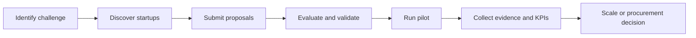

🚀 StartupSetu
Discover Innovation · Prove Impact · Scale What Works
An innovation-to-impact platform connecting startups, evaluators, validators, and government stakeholders.
    
✨ Features · 🧭 Workflow · ⚡ Quick Start · 🧱 Tech Stack · 👤 Maintainer

🌟 About the Project
StartupSetu brings the innovation lifecycle into one interface—from identifying real-world challenges to discovering startup solutions, evaluating proposals, managing pilots, and documenting evidence for scale-up and procurement decisions.
Vision: Make it easier to move from a promising idea to a measurable, evidence-backed solution.

✨ Features
Area	What you can explore
🧩 Challenge Marketplace	Browse challenges and explore opportunities
🤖 AI Challenge Builder	AI-assisted challenge creation workflows
🚀 Startup Discovery	Startup profiles and matching interface
📝 Proposal Submission	Proposal submission and review workflows
🧑‍⚖️ Evaluation & Validation	Dedicated evaluator and validator dashboards
🏛️ Government & Admin	Role-specific government and administration views
🧪 Pilot Management	Track pilots and supporting evidence
📘 Evidence Passport	Organize evidence associated with outcomes
📊 KPI Dashboard	Visual reporting and performance indicators
📦 Scale & Procurement	Scale planning and procurement decision packs
🔎 Audit Trail	Activity and decision-tracking interface
💬 Support Chatbot	In-app support experience

These are modules present in the project source. Production integrations and end-to-end workflows should be tested before public deployment.

🧭 How It Works

<strong>👥 Explore the platform roles</strong>

Role	Relevant interface
Startup	Startup profile, matching, proposal submission
Evaluator	Evaluator dashboard and review workflows
Validator	Validator dashboard
Government	Government dashboard and proposals
Admin	Administration dashboard

<strong>🗂️ Explore important source files</strong>

sih-2026-main/
├── App.jsx                      # Application UI
├── main.jsx                     # React entry point
├── LandingPage.jsx              # Landing experience
├── ChallengeMarketplace.jsx     # Challenge discovery
├── AIChallengeBuilder.jsx       # AI-assisted builder
├── StartupMatching.jsx          # Startup matching
├── ProposalSubmission.jsx       # Proposal flow
├── EvaluatorDashboard.jsx       # Evaluator workspace
├── ValidatorDashboard.jsx       # Validator workspace
├── GovDashboard.jsx             # Government workspace
├── AdminDashboard.jsx           # Admin workspace
├── PilotManagement.jsx          # Pilot workflow
├── EvidencePassport.jsx         # Evidence tracking
├── KPIDashboard.jsx             # KPI visualizations
├── aiEngine.js                  # AI-related logic
├── db.js / routes.js            # Data and route logic
├── package.json                 # Scripts and dependencies
└── vite.config.js               # Vite configuration

🧱 Tech Stack
Layer	Technology
Frontend	React 18, Vite 5
Styling	Tailwind CSS 3
Charts	Recharts
Icons	Lucide React
Server-side packages	Express, CORS
Deployment config	Vercel

⚡ Quick Start
Prerequisites: Node.js and npm installed.
1. Download or clone your own repository and open the project folder.
2. Install dependencies:
   npm install
3. Start the development server:
   npm run dev
4. Open the local URL printed in the terminal (typically http://localhost:5173).
📦 Production Build
npm run build
npm run preview
Backend note: npm run server and npm start currently point to server/index.js, but that file is not present in the provided archive. Those commands need the missing server implementation or updated scripts.

🖼️ Screenshots & Demo
Screenshots and a hosted demo URL have not been provided. Once available, add real screenshots of the landing page, challenge marketplace, and dashboards here. Avoid using placeholder links as if they were live demos.
🔐 Security & Data Notes
The supplied project includes a store.json file that may contain application user records. Inspect and sanitize or exclude it before publishing a public repository. Never publish real credentials, personal information, tokens, or secrets. Validate authentication, data persistence, and access controls before production use.
🤝 Contributing
Suggestions and improvements are welcome. If you publish this repository, contributors can open an issue describing a bug or feature and submit a pull request with a clear explanation of the change.
👤 Maintainer
Nitish Kumar Singh
 
- 📧 Email: nitishofficial9026@gmail.com
- 💻 GitHub: github.com/Nitish12Singh
📄 License
No license was specified in the supplied project. Add one only after confirming ownership and redistribution permissions.

Built to bridge innovation and real-world impact. 🌉

⭐ If you find the project useful, consider starring the repository once it is published.

